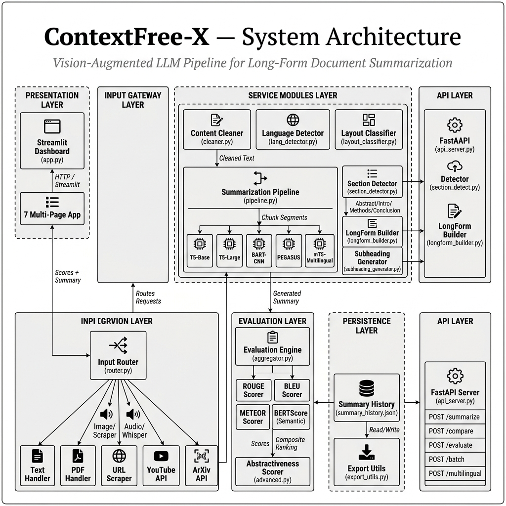

# COMPASS — System Architecture

> **Vision-Augmented LLM Pipeline for Long-Form Document Summarization**



---

## Overview

COMPASS (formerly ContextFree-X) is a research-grade, multi-domain text summarization system built on top of HuggingFace transformer models. It supports diverse input modalities, multiple summarization models, multilingual routing, structured evaluation metrics, and a multi-page Streamlit frontend — all running **fully offline and locally**.

---

## Architecture Layers

```
┌─────────────────────────────────────────────────────────────────────┐
│                        INPUT SOURCES                                │
│  Text │ PDF │ URL │ Audio │ YouTube │ ArXiv │ Image/Vision          │
└───────────────────────────┬─────────────────────────────────────────┘
                            │
┌───────────────────────────▼─────────────────────────────────────────┐
│                   INPUT ROUTING & PREPROCESSING                     │
│  router.py → handler dispatch → cleaner.py → lang_detector.py      │
│                          layout_classifier.py                       │
└───────────────────────────┬─────────────────────────────────────────┘
                            │
┌───────────────────────────▼─────────────────────────────────────────┐
│                    SUMMARIZATION PIPELINE                           │
│                                                                     │
│  preprocessing.py → pipeline.py (chunking + routing)               │
│                         │                                           │
│         ┌───────────────┼──────────────────┐                       │
│         │               │                  │                       │
│  section_detector  longform_builder  subheading_generator          │
│  (Paper Sections)  (Recursive Merge)  (Auto Titles)                │
│         │               │                  │                       │
│         └───────────────┼──────────────────┘                       │
│                         ▼                                           │
│              ┌─────────────────────┐                               │
│              │  Transformer Models │                               │
│              │  ┌───────────────┐  │                               │
│              │  │  T5-Base      │  │                               │
│              │  │  T5-Large     │  │                               │
│              │  │  BART-CNN     │  │                               │
│              │  │  PEGASUS      │  │                               │
│              │  │  mT5 (Multi)  │  │                               │
│              │  └───────────────┘  │                               │
│              └─────────────────────┘                               │
└───────────────────────────┬─────────────────────────────────────────┘
                            │
┌───────────────────────────▼─────────────────────────────────────────┐
│              POST-PROCESSING & EVALUATION                           │
│                                                                     │
│  postprocessing.py → advanced.py (Abstractiveness Scorer)          │
│                                                                     │
│  Evaluation Engine (evaluation/)                                   │
│  ┌──────────┐ ┌──────────┐ ┌──────────┐ ┌──────────────────────┐  │
│  │  ROUGE   │ │  BLEU    │ │  METEOR  │ │ BERTScore (Semantic) │  │
│  └──────────┘ └──────────┘ └──────────┘ └──────────────────────┘  │
│                    aggregator.py (composite ranking)               │
└───────────────────────────┬─────────────────────────────────────────┘
                            │
┌───────────────────────────▼─────────────────────────────────────────┐
│                 PRESENTATION & API LAYER                            │
│                                                                     │
│  ┌─────────────────────────┐   ┌─────────────────────────────────┐ │
│  │  FastAPI Server          │   │  Streamlit Multi-Page App       │ │
│  │  api_server.py           │   │  app.py + pages/                │ │
│  │                          │   │                                 │ │
│  │  POST /summarize         │   │  1_Summarize.py                 │ │
│  │  POST /compare           │   │  2_Compare_Models.py            │ │
│  │  POST /evaluate          │   │  3_Metrics_Dashboard.py         │ │
│  │  POST /batch             │   │  4_Batch_Evaluate.py            │ │
│  │  POST /multilingual      │   │  5_Multilingual.py              │ │
│  │  POST /blueprint         │   │  6_Blueprint_Summarizer.py      │ │
│  │  GET  /history           │   │  7_History.py                   │ │
│  └─────────────────────────┘   └─────────────────────────────────┘ │
└─────────────────────────────────────────────────────────────────────┘
```

---

## Module Breakdown

### `input_handlers/`
| File | Responsibility |
|------|---------------|
| `router.py` | Detects input type, dispatches to correct handler |
| `pdf_handler.py` | Extracts text from PDFs (PyMuPDF + layout-aware) |
| `url_handler.py` | Web scraping with BeautifulSoup / trafilatura |
| `youtube_handler.py` | Transcript extraction via youtube_transcript_api |
| `audio_handler.py` | Speech-to-text via Whisper |
| `arxiv_handler.py` | ArXiv paper fetch + metadata |
| `image_handler.py` | Vision-based OCR and description |
| `blueprint_handler.py` | Structured blueprint document parsing |
| `cleaner.py` | Noise removal, normalization |
| `lang_detector.py` | Language auto-detection |
| `layout_classifier.py` | Document layout type classifier |

### `summarizer/`
| File | Responsibility |
|------|---------------|
| `models.py` | Model registry + HuggingFace loader |
| `pipeline.py` | Core chunking + summarize orchestration |
| `preprocessing.py` | Token-aware text splitting |
| `postprocessing.py` | Output cleaning, deduplication |
| `advanced.py` | Abstractiveness + novelty scoring |
| `section_detector.py` | Research paper section extraction |
| `longform_builder.py` | Recursive merge for long documents |
| `subheading_generator.py` | Auto-generates section titles |

### `evaluation/`
| File | Responsibility |
|------|---------------|
| `rouge_scorer.py` | ROUGE-1, ROUGE-2, ROUGE-L |
| `bleu_scorer.py` | BLEU score |
| `meteor_scorer.py` | METEOR score |
| `bert_scorer.py` | BERTScore (F1, Precision, Recall) |
| `aggregator.py` | Composite ranking across all metrics |

### `pages/`
| Page | Feature |
|------|---------|
| `1_Summarize.py` | Main summarization UI, all input types |
| `2_Compare_Models.py` | Side-by-side model comparison |
| `3_Metrics_Dashboard.py` | Radar charts, metric bars |
| `4_Batch_Evaluate.py` | CSV bulk processing + export |
| `5_Multilingual.py` | Multi-language summarization |
| `6_Blueprint_Summarizer.py` | Blueprint document mode |
| `7_History.py` | Persistent session history |

---

## Key Technologies

| Category | Stack |
|----------|-------|
| **Frontend** | Streamlit, custom CSS theme |
| **API** | FastAPI, Uvicorn |
| **Models** | HuggingFace Transformers (T5, BART, PEGASUS, mT5) |
| **Evaluation** | rouge-score, nltk, bert-score, sacrebleu |
| **PDF** | PyMuPDF (fitz), pdfminer |
| **Audio** | OpenAI Whisper |
| **Vision** | DETR, PIL, Tesseract OCR |
| **NLP Utilities** | langdetect, trafilatura, youtube-transcript-api |
| **Charts** | Plotly, Matplotlib |
| **Storage** | JSON history (summary_history.json) |

---

## Data Flow Summary

```
User Input
    │
    ▼
Input Router (type detection)
    │
    ├─► PDF Handler ──────────────────────┐
    ├─► URL Scraper ──────────────────────┤
    ├─► YouTube Transcript ───────────────┤
    ├─► Audio Whisper ────────────────────┼─► Cleaned Text
    ├─► ArXiv API ────────────────────────┤
    ├─► Vision OCR ───────────────────────┤
    └─► Raw Text ─────────────────────────┘
                                          │
                                          ▼
                              Language Detection
                                          │
                              Layout Classification
                                          │
                                          ▼
                              Chunking + Preprocessing
                                          │
                              ┌───────────┼───────────┐
                              ▼           ▼           ▼
                           T5-Base    BART-CNN    PEGASUS
                           T5-Large   mT5 (multilingual)
                              └───────────┼───────────┘
                                          │
                                          ▼
                              LongForm Merge + Post-Processing
                                          │
                                          ▼
                              Evaluation (ROUGE/BLEU/BERT/METEOR)
                                          │
                                          ▼
                              Streamlit UI / FastAPI Response
```

---

*COMPASS — Research-Grade Multi-Domain Text Summarizer*
