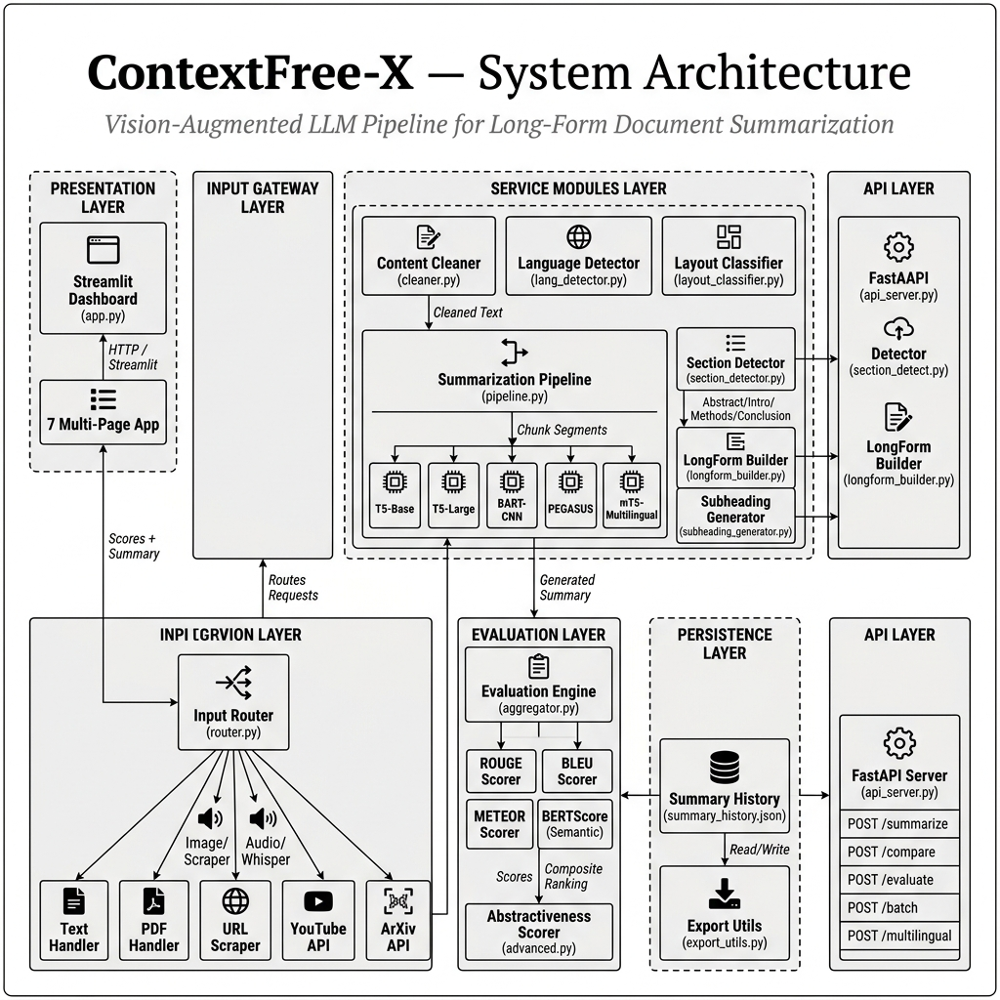

# COMPASS — Comparative Multi-model Pipeline with Adaptive Semantic Scoring

A local, multi-model text summarizer with built-in evaluation. Paste text or point it at a
PDF, web page, YouTube video, arXiv paper or image; COMPASS summarizes it with up to five
HuggingFace transformer models, scores every summary with ROUGE, BLEU, METEOR and
BERTScore, and tells you which model did best and why.

Everything runs on your machine with downloaded model weights. The only optional cloud
call is the Claude Vision tier of the blueprint reader.



## Features

| Page | What it does |
|---|---|
| **Summarize** | Text, PDF, URL, YouTube transcript, arXiv paper or image → a structured, paragraph-per-section summary; Markdown / Word export. Research-paper PDFs can be summarized by section (Abstract, Introduction, Conclusion). |
| **Compare Models** | One input, several models side by side, with metric cards and a "best model" pick. |
| **Metrics Dashboard** | Radar chart, composite ranking and a full score table across models. |
| **Batch Evaluate** | CSV with a `text` column (and optional `reference`) → per-row summaries and scores, CSV export. |
| **Multilingual** | Detects the language (English, Tamil, Hindi, French, German, Spanish, Chinese, Arabic), summarizes with mT5-XLSum and translates the result to English. |
| **Blueprint Summarizer** | Floor plans (image / PDF / DXF) → rooms, dimensions and areas via Claude Vision, LLaVA (Ollama) or Tesseract OCR. |
| **History** | Your last 100 summaries, stored locally in `summary_history.json`. |

Models (configured in [`config/model_config.yaml`](config/model_config.yaml)): T5-Base,
T5-Large, BART-large-CNN, PEGASUS-CNN/DM and mT5-multilingual-XLSum.

## Quick start

Python 3.11 is recommended.

```bash
python -m venv venv311
# Windows: venv311\Scripts\activate    macOS/Linux: source venv311/bin/activate

# CPU-only PyTorch keeps the install small; skip this line if you have a CUDA GPU
pip install torch --index-url https://download.pytorch.org/whl/cpu
pip install -r requirements.txt

streamlit run app.py
```

Models download from HuggingFace the first time each one is used (BART ≈ 1.6 GB,
T5-Base ≈ 0.9 GB, T5-Large ≈ 3 GB, PEGASUS ≈ 2.3 GB, mT5 ≈ 2.3 GB, plus RoBERTa-large
≈ 1.4 GB for BERTScore). Set `HF_HOME` to put the cache on a drive with space.

### REST API and the standalone UI

```bash
uvicorn api_server:app --port 8502
```

Then open `stitch/ui/index.html` in a browser; it talks to the API on port 8502.
Interactive API docs are at <http://127.0.0.1:8502/docs>. Running `python api_server.py`
binds to `127.0.0.1` only; set `COMPASS_API_HOST=0.0.0.0` to expose it on your network.

### Optional extras

| For | You need |
|---|---|
| Blueprint → Claude Vision tier | `ANTHROPIC_API_KEY` in your environment (never in code). Uses `claude-opus-5-5`; override with `COMPASS_CLAUDE_MODEL`. |
| Blueprint → LLaVA tier | [Ollama](https://ollama.com) running locally with `ollama pull llava:13b` |
| Blueprint → OCR tier | Tesseract OCR installed (`packages.txt` lists the apt packages for Streamlit Cloud) |
| Layout-aware PDF parsing | `layoutparser` plus a Detectron2 or EfficientDet backend. Without it, PyMuPDF reads the PDF's text layer, which handles two-column papers well. |

## How summaries are scored

Every score needs something to compare against, and COMPASS uses one of two modes:

| You provide | Mode | ROUGE-1/2/L | BLEU | METEOR, BERTScore |
|---|---|---|---|---|
| A reference summary (Compare, Metrics, Batch `reference` column, API `reference`) | **Reference** | F1 | Smoothed sentence BLEU-4 | Standard |
| Nothing | **Source** | Precision vs. the source text | Unigram precision, no brevity penalty | Against the source |

In source mode the scores measure how much of the summary is supported by the input text,
which is a faithfulness signal rather than quality against a human-written summary. Recall
against a long source is meaningless for a short summary, which is why precision is used
there. The UI and API (`scored_against`) always say which mode produced a score.

BERTScore uses `roberta-large` and is not baseline-rescaled, so most fluent summaries land
around 0.8–0.9; compare models with each other rather than reading the absolute value.

The **composite score** is a weighted sum (ROUGE-1 0.20, ROUGE-2 0.20, ROUGE-L 0.15,
BLEU 0.10, METEOR 0.10, BERTScore F1 0.25), read from `config/model_config.yaml` so you
can change it there. **Abstractiveness** is the share of summary words that don't appear
in the source; **compression** is summary length divided by source length.

## Tests

```bash
pip install -r requirements-dev.txt
pytest                # fast suite: no model downloads (also runs in GitHub Actions)
pytest -m slow        # end-to-end with real BART / T5 / BERTScore models
```

The fast suite covers chunking, section detection and merging, PDF section extraction,
language detection (including unspaced scripts like Chinese), both metric modes, history,
the REST API (with models stubbed out), the Claude Vision request, and a headless render of
every Streamlit page.

## Benchmark

`python compare_models.py` summarizes CNN/DailyMail test articles with BART, T5 and
PEGASUS and reports ROUGE, BLEU and BERTScore against the human highlights (the code is in
`modules/`).

## Project layout

```
app.py, pages/            Streamlit multi-page UI
api_server.py             FastAPI bridge for the standalone UI in stitch/ui/
summarizer/               model registry, chunking, long-form builder, section detection
input_handlers/           PDF, URL, YouTube, arXiv, image, audio, CSV, language detection
evaluation/               ROUGE, BLEU, METEOR, BERTScore and the composite ranking
vision_summarizer/        blueprint reading (Claude Vision / LLaVA / OCR) and area maths
components/               shared Streamlit UI pieces and theme
modules/                  CNN/DailyMail benchmark used by compare_models.py
config/model_config.yaml  models, generation limits and metric weights
tests/                    pytest suite
```

More detail: [ARCHITECTURE.md](ARCHITECTURE.md),
[PROJECT_MODULES.md](PROJECT_MODULES.md) and
[LONGFORM_SUMMARY_EXPLAINED.md](LONGFORM_SUMMARY_EXPLAINED.md).
